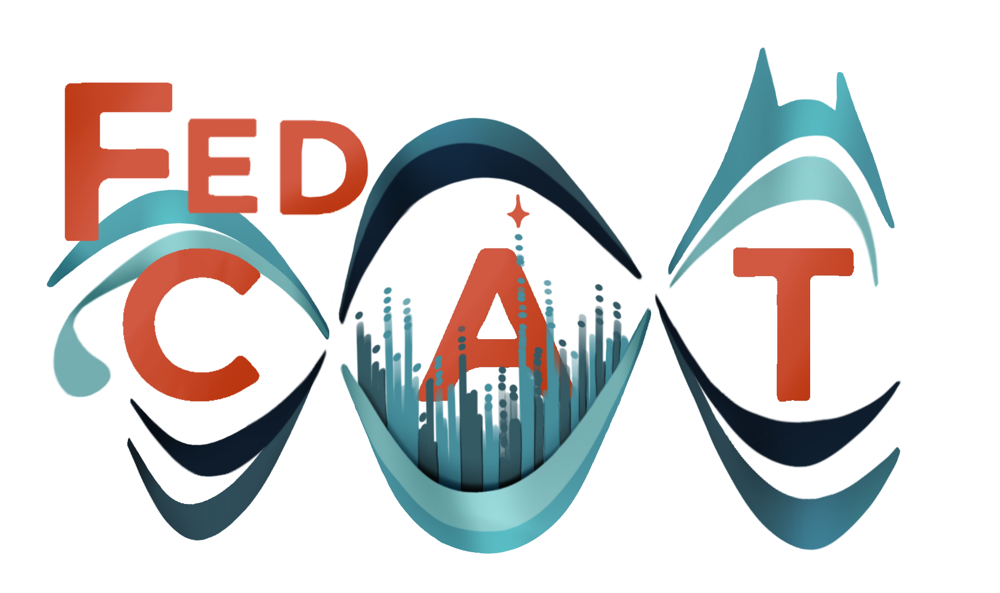

# FedCAT — Federated Conditional Association Testing

This directory contains the `fedcat` Python package for running end-to-end federated discovery workflows across All of Us (AoU) and UK Biobank (UKB).

## Overview

`fedcat` drives all stages of our cross-biobank WGS association analysis from a single command and config file:

- **step1** — run REGENIE step 1 (per-cohort/stratum)
- **step2_singles** — run REGENIE step 2 single-variant analysis (per-cohort/stratum)
- **step2_aggregates** — run REGENIE step 2 aggregate analysis (per-cohort/stratum)
- **meta_analysis** — copy UKB summary stats into the AoU bucket and run meta-analysis
- **step0_subset** — collect the significant meta-analysis results at `cond_p_singles_retest` / `cond_p_agg_retest` into the step-0 conditioning input. Subsets are kept per threshold, so this reuses the subsets the meta-analysis built, and only subsets again (from the meta-analysis outputs already in the cloud) for thresholds not built before
- **conditioning_singles** / **conditioning_aggregates** — federated forward-selection: iteratively run per-cohort/stratum conditional analyses, download results, meta-analyse, select the top unit per chromosome and repeat until no units remain below the p-value threshold

Key features:
- Supports running up to 20 phenotypes simultaneously, taking advantage of REGENIE's multi-phenotype support for discovery steps.
- Each phase is an independent state machine; progress is saved to JSON state files on increment or error so runs can be resumed after transient failures.
- Designed to be run from the terminal in an AoU Jupyter analysis environment.

## Documentation

This README is a summary. The full documentation, with a guide to each phase, a page per subcommand and an API reference generated from the docstrings, is a site built with [Zensical](https://zensical.org/) from [`docs/`](./docs). To read it locally, from this directory:

```bash
pip install -e ".[docs]"
python tools/docs/gen_docs.py   # generate the reference content
zensical serve                  # then open http://localhost:8000
```

Every subcommand's options are also on one page in [docs/options_reference.md](./docs/options_reference.md).

## Setup

First, clone this repo on an AoU Verily Jupyter instance (recommend following [verily github integration](https://support.workbench.verily.com/docs/guides/cloud_apps/git_integrations/)). Otherwise, you will need to clone the repo directly using a personal access token (go to https://github.com/settings/personal-access-tokens and create a token with `ExeterGenetics` as resource owner, choose `All repositories` (or select just this one), add `Contents` permission (leave as read-only), then `git clone https://github.com/ExeterGenetics/biobank_workflows.git` and paste in token instead of password when prompted).

Once the repo is cloned to the Jupyter instance, run the install script as below:

```bash
# Run script to install FedCAT into ./fedcat_runs (optional first argument sets a different directory)
bash repos/biobank_workflows/regenie_workflows/create_working_directory.sh
# Move into the created directory and activate the venv where FedCAT is installed
cd fedcat_runs
source venv/bin/activate
# If not run already use setup-workflows command to add workflows to your workspace
fedcat setup-workflows
# FedCAT is now ready for all your association testing needs!
fedcat discover --config your_config.json
```
Additional Notes:
- FedCAT requires python ≥ 3.10 (already present in AoU)
- Authentication on AoU: `fedcat` uses `google-auth` Application Default Credentials (ADC) and the `wb` command line tool. In the AoU analysis environment these are typically already configured.
- Authentication with DNAnexus: `dx login`
- If not installed as above:
  - Ensure [`variant_density_blocks.tsv`](./setup_files/variant_density_blocks.tsv) or your own blockfile which approximates 100k variant blocks is in working directory (if non-default use `--variant-density-blockfile`)
  - Make sure all the wdl workflows are added to your workspace (see [setup_helpers](../../setup_helpers/)), or if using Cromwell server on the instance, ensure all wdls and options file in working directory (Cromwell in instance is untested)

## Config

All configuration lives in a single JSON file with the `DiscoveryConfig` schema described below. See the [configs/](./configs) directory for real examples.

Only the options a run actually uses are required, for example a singles-only run needs no annotations while a run without the meta-analysis phase requires no `meta_analysis_config`. See comments in the below schema for details.

```jsonc
{
  // Environment fedcat itself is running in: "aou" when running from an AoU
  // Jupyter instance, "local" for runs on another server/laptop/instance.
  // A cohort that forbids data egress (AoU) can only be run with local_env "aou".
  "local_env": "aou",

  // ── Per-biobank cohort configuration ─────────────────────────────────────
  // Include only the biobanks you want to run (aou, ukb, or both).
  "cohorts": {
    "aou": {
      // Workflow names in Verily workspace (or WDL filenames if using local Cromwell server)
      "workflows": {
        "regenie_step1": "regenie_step1_scatter_aou",
        "regenie_step2_singlevar": "regenie_step2_single_variants_aou",
        "regenie_step2_aggregate": "regenie_step2_aggregates_aou",
        "conditioning_singlevar": "regenie_conditioning_singles_aou",
        "conditioning_aggregate": "regenie_conditioning_agg_aou",
        // Optional resources per workflow, keyed by names above (plus "meta_workflow" and "subset_workflow").
        // Omitted workflows keep their defaults. AoU takes n_cpu, mem_gb, disk,
        // max_retries and preemptible; disk is "<GB> SSD" or "<GB> HDD". max_retries
        // is how many times a failed task is retried (0 = none, the WDL default);
        // preemptible is how many attempts run on a spot VM before falling back to a
        // standard one (0 = never use spot). Examples below are extra memory for agg
        // cond, a smaller disk for a run over a subset of individuals, and step1 kept
        // off spot VMs with one retry.
        "resources": {
          "conditioning_aggregate": {"n_cpu": 8, "mem_gb": 128},
          "regenie_step2_singlevar": {"disk": "200 SSD"},
          "regenie_step1": {"preemptible": 0, "max_retries": 1}
        }
      },
      // Google bucket path, gs:// prefix is optional
      "pheno_file": "gs://workspace-bucket/path/to/pheno.tsv.gz",
      // Google bucket path, gs:// prefix is optional
      "cov_file": "gs://workspace-bucket/path/to/covs.tsv.gz",
      // Google bucket path to file of variants to ALWAYS condition on (optional)
      "cond_file": "gs://workspace-bucket/path/to/cond_variants",
      // Sample strata to run and meta-analyse (e.g. genetic ancestry groups)
      // All individuals should be in the single phenotype file
      // Each stratum's samples are those of its step1 input file (step1_input_template)
      // Names may only contain letters, digits and '-'
      "strata": ["afr", "amr", "eas", "eur", "mid", "sas"],
      // Comma-separated list of categorical covariates
      "cat_vars": "seq_center",
      // Directory where REGENIE step 1 output goes (relative to workspace bucket)
      "step1_directory": "regenie_step1_output",
      // Root directory for all other results output (relative to workspace bucket)
      "root_results_directory": "wgs_analysis2/vYYYY.MM",
      // Full template path to plink2 pgen files with {chr} placeholder
      // {chr} is substituted with the chromosome number at runtime
      // must exclude the pfile set extensions (.pgen/.pvar/.psam)
      "pfile_template": "gs://wgs-bucket/path_to_pgens/chr{chr}_pgen_name",
      // Full template path to plink bed step 1 input files with {stratum} placeholder
      // {stratum} is substituted with each of strata at runtime
      // must exclude the bfile/pfile set extensions
      "step1_input_template": "gs://wgs-bucket/path_to_regenie_step1_input/regenie_step1_{stratum}",
      // List of REGENIE-style annotation file triplets for aggregate testing
      // Required only for the step2_aggregates / conditioning_aggregates phases;
      // omit the field entirely (or pass []) if you are only running single-variants
      "regenie_annotations": [
        {"name": "coding", "mask_file": "gs://...", "annot_file": "gs://...", "setlist_file": "gs://..."},
        {"name": "proximal", "mask_file": "gs://...", "annot_file": "gs://...", "setlist_file": "gs://..."}
      ],
      // Dict of cohort sizes per stratum, used to determine step2 block sizes
      // Accurate values reduce costs; defaults to 100,000 per stratum if omitted
      "cohort_sizes": { "afr": 84000, "amr": 79000, "eas": 10000, "eur": 234000, "mid": 1500, "sas": 5500 },
      // Version of the staged workflow dependencies to use (default: 1.7.1).
      // Must match a version staged by `fedcat setup-workflows`. With the wb_cli backend fedcat
      // runs whichever registered workflow runs that version's staged WDL, whatever its name.
      "dependencies_version": "1.7.1",
      // Workflow submission backend for AoU cohorts (default: "wb_cli").
      // "local_cromwell" submits to a Cromwell server on this machine; see
      // "Running Cromwell yourself" below (set CROMWELL_URL if not on port 8000).
      "workflow_backend": "wb_cli",
      // Split each step1/step2 phase over workflows of at most this many tasks
      // (default: 0, one workflow). Needed for large phenotype sets, e.g. pwas
      "max_tasks_per_workflow": 5000,
      // Most jobs (AoU workflows / UKB applet jobs) running at once (default: 0, no limit)
      "max_concurrent_jobs": 10
    },
    "ukb": {
      // Same structure as AoU except where noted
      // UKB workflow values are DNAnexus applet IDs (applet-xxxx format)
      "workflows": {
        "regenie_step1": "applet-xxxx",
        "regenie_step2_singlevar": "applet-xxxx",
        "regenie_step2_aggregate": "applet-xxxx",
        "conditioning_singlevar": "applet-xxxx",
        "conditioning_aggregate": "applet-xxxx",
        // UKB applet sizes are set using DNAnexus instance type strings, and priority
        // is "high" (on-demand machines), "normal" or "low" (cheaper spot machines,
        // but the job fails if one is reclaimed). Example below is extra cpu memory
        // for agg cond, and step1 on on-demand machines.
        "resources": {
          "conditioning_aggregate": {"instance_type": "mem3_ssd1_v2_x32"},
          "regenie_step1": {"priority": "high"}
        }
      },
      // DNAnexus file IDs or paths are acceptable in the config
      // paths should include project (i.e full project-xxx:/path/to/file)
      "pheno_file": "file-xxxx",
      "cov_file": "file-xxxx",
      "cond_file": "file-xxxx",
      "ancs": ["afr", "eur", "sas"],
      "cat_vars": "centre,sequencing_centre",
      "step1_directory": "regenie_step1_output",
      "root_results_directory": "wgs_analysis2/v2026.2",
      "pfile_template": "project-xxx:/500k_wgs_pgens/dragenml_genoqc_pgens/chr{chr}_trimmed_merged_nofail",
      "step1_input_template": "project-xxx:/regenie_step1_input/regenie_step1_{stratum}",
      // You can use file ids or paths for annot files, they will be passed to applets as paths
      // therefore all files must be unique on their path even if passed as id
      "regenie_annotations": [
        {"name": "coding", "mask_file": "project-xxx:/...", "annot_file": "project-xxx:/...", "setlist_file": "project-xxx:/..."},
        {"name": "proximal", "mask_file": "project-xxx:/...", "annot_file": "project-xxx:/...", "setlist_file": "project-xxx:/..."}
      ],
      "cohort_sizes": { "afr": 10000, "eur": 460000, "sas": 10000 },
      // DNAnexus project where this cohort's jobs run and results are output.
      // Optional; falls back to the top-level dx_project_id. Set per-cohort only
      // when running two DNAnexus biobanks out of different projects.
      "dx_project_id": "project-xxxx",
      // DNAnexus project the applets live in (optional; defaults to the shared
      // applet project)
      "applet_project_id": "project-xxxx"
    }
  },

  // ── Other required fields ────────────────────────────────────────────────

  // List of phenotype names to run (up to 20).
  // All phenotype/covariate files must contain columns for each name.
  "pheno_names": ["pheno1", "pheno2"],
  // Binary phenotypes are not currently tested or recommended for conditioning phases.
  "trait_type": "Binary or Continuous",
  // MCC not recommended with the current REGENIE version
  // Binary phenotypes should use RAW
  "trait_transform": "RINT or MCC or RAW",
  // List of chromosomes to run
  "chromosomes_to_run": ["1", "2", "X"],
  // All state JSONs, logs, and results will be placed in subdirectories of this path.
  // Directory will be created if it does not already exist.
  "local_run_path": "/home/jupyter/looping/run_folder",
  // Prefix appended to the top-level run directory and outputs
  "run_prefix": "run_identifier",
  
  // ── Conditioning suffix ──────────────────────────────────────────────────
  // Required only when a conditioning_ phase is in the phases being run; omit otherwise.
  // Appended to conditioning run subdirectory names.
  "cond_suffix": "run1",

  // ── Meta-analysis config ─────────────────────────────────────────────────
  // Required only when meta_analysis or step0_subset is in the phases being run; omit otherwise.

  "meta_analysis_config": {
    // Where the meta-analysis and step-0 subset jobs run. "aou" means AoU, "local" means a DNAnexus applet.
    "location": "aou",
    // Verily workspace workflow name / WDL name OR dx applet id (required for meta_analysis)
    "meta_workflow": "meta_analysis_discovery_aou",
    // Workflow name / WDL name OR dx applet id (regenie_step0_subset) (required for step0_subset)
    "subset_workflow": "step0_subsetting_only_aou",
    // ONE OR OTHER of the below meta-analysis annotation file inputs. Required
    // only when the meta-analysis runs its burden/ACAT stages, i.e. --meta-mode
    // "all" or "aggregates_only" (the default --meta-mode auto picks these whenever
    // --phases-to-run includes an aggregates phase, or the only phase is meta_analysis).
    // Option A: Parquet schema. Point to directory with 6-file converted annotations
    "schema_directory": "gs://workspace-bucket/wgs_annotations/v2026.2/parquet_all_chr{chr}",
    // Option B: Manifest of REGENIE-style TSV files (same format as at cohort-level)
    "regenie_annotations": [
      {"name": "coding", "mask_file": "...", "annot_file": "...", "setlist_file": "..."},
      {"name": "proximal", "mask_file": "gs://...", "annot_file": "gs://...", "setlist_file": "gs://..."}
    ]
  },

  // ── Covariate exclusion (all optional, and all additive) ─────────────────
  // For each chromosome the three sources below are concatenated into regenie's --covarExcludeList

  // PGS covariate column prefix: the column {pgs_prefix}{chrom} is excluded on
  // each chromosome, so step2 for chr1 drops XX_SCORE_CHR1
  // Omit if you are not using LOCO PGS covariates
  "pgs_prefix": "XX_SCORE_CHR",
  // Chromosomes where there is no PGS covariate to adjust for (default: []).
  "chromosomes_no_pgs": ["X"],
  // Covariate columns to exclude on every chromosome (default: [])
  "exclude_covars": ["irrelevant_covar1", "irrelevant_covar2"],
  // Extra per-chromosome exclusions, keyed by chromosome (default: {}).
  "exclude_covars_dict": { "X": ["X_PGS"], "6": ["HLA_score2"] },

  // ── Covariate-stratified analysis (optional) ─────────────────────────────
  // When set, `fedcat discover` runs one complete, independent analysis per
  // listed value of a covariate (e.g. sex, or a disease state) instead of one
  // analysis over everyone. Each covariate stratum gets its own run_prefix
  // (`{run_prefix}_{name}`, e.g. `{run_prefix}_female`), and therefore its own
  // step1 fit, output tree, run directory, state files and conditioning results.
  // The combined run, if requested, keeps the bare run_prefix. The covariate is
  // excluded from the regenie covariates within each covariate stratum.
  //
  // Use the `--covar-stratum female male combined` command line option to
  // restrict a run to some of them; by default every one runs, in parallel.
  "stratify_by_covar": {
    // Column of each cohort's cov_file to stratify on
    "covar_name": "sex",
    // Values in that column to analyse, compared as strings exactly as they
    // appear, each mapped to its covariate stratum name. Any number of values.
    "covar_values_names": { "2": "female", "1": "male" },
    // Whether to also run the unstratified analysis (default: true)
    "also_run_combined": true
  },

  // ── Additional optional fields ───────────────────────────────────────────

  // Prefix for step1 output files (default: run_prefix).
  // Set this to reuse step1 output for multiple step2 runs that use a
  // different run_prefix (e.g. different annotation versions)
  "step1_run_prefix": "generic_phenotype_group",
  // Phenotypes fitted together per step1 job (default: 0, all in one fit).
  // Each set writes to "<step1_run_prefix>_set<N>" when there is more than one.
  "step1_pheno_group_size": 20,
  // Phenotypes tested together per step2 task (default: 0, all together).
  // A group reads the merged predictions of every step1 set holding its phenotypes,
  // so it can be larger than a step1 set; outputs are tagged "_g<N>" when grouped.
  "step2_pheno_group_size": 250,
  // Ceilings on the step2 block length in bp, which otherwise grows as cohorts
  // shrink (default: null for singles; 20 Mb for wdl aggs; 30 Mb for dx applet aggs).
  "max_step2_singles_block_length": 50000000,
  "max_step2_aggregates_block_length": 40000000,
  // DNAnexus project where UKB jobs run and results are output
  // (default: our main UKB_500k_WGS project)
  "dx_project_id": "project-xxxx",
  // GCS bucket where AoU results are output. If unset, fedcat lists the available
  // workspace buckets to choose from, then saves choice to persisted state file.
  "aou_bucket": "workspace-bucket",
  // Workbench resource id for the above bucket (used for `wb --bucket-id`).
  // Resolved automatically alongside aou_bucket; only set it to override.
  "aou_bucket_resource_id": "workspace-bucket-resource-id",
  // regenie version every step1/step2/conditioning job runs, on both biobanks
  // (default: "4.1.3"; also "4.1").
  "regenie_version": "4.1.3",
  // MAC threshold for testing single variants (default: 11)
  "singles_mac_threshold": 11,
  // Aggregate aaf thresholds (strings passed verbatim to REGENIE --aaf-bins; default: ["0.001"])
  "aggregate_freqs": ["0.001"],
  // Take ACAT mask START/END from all annotated variants, not only those with
  // single-variant results, so burden-only masks get positions (default: true).
  // This makes ACAT tests take 30-40% longer
  "acat_full_bounds": true,
  // A stratum's single-variant result enters an aggregate bin's ACAT only where the
  // variant is rare (A1FREQ <= bin) in that stratum, as a single-stratum ACAT would,
  // rather than filtering on the meta-analysed A1FREQ (default: true).
  // Fixed for a run: changing it means re-running from the meta-analysis
  "acat_singles_stratum_rare": true,
  // Whether to restrict aggregate testing to coding sets (default: false)
  // This activates a simple grep for sets that start with 'coding_'
  // Only recommended to use with old annotation files where set types are mixed
  "coding_only": false,
  // GxE interaction testing (REGENIE --interaction; default: off).
  // Names a column in the covariate file. Use "VAR[BASE]" to set the baseline level
  // of a categorical variable, and list it in cat_vars. See the interaction notes below.
  // NOTE: currently ONLY IMPLEMENTED FOR STEP2 SINGLE VARIANTS not AGGREGATES or CONDITIONING
  "interaction": "bmi",

  // ── Conditioning thresholds ──────────────────────────────────────────────

  // Results with p > cond_p_agg_retest are dropped at each aggregate step, and left out of the step-0 subset (default: 1e-6)
  "cond_p_agg_retest": 1e-6,
  // Units with p < cond_p_agg_select can be added to the selected set, must be <= cond_p_agg_retest (default: 1e-7)
  "cond_p_agg_select": 1e-7,
  // Results with p > cond_p_singles_retest are dropped at each singles step, and left out of the step-0 subset (default: 1e-6)
  "cond_p_singles_retest": 1e-6,
  // Single variants with p < cond_p_singles_select can be added to the selected set, must be <= cond_p_singles_retest (default: 5e-8)
  "cond_p_singles_select": 5e-8,
  // Maximum r-squared (by selected set) threshold for adding single variants to the selected set (default: 0.9)
  // Doubles as the COJO collinearity cutoff when cond_engine is "mancojo"
  "cond_rsq_threshold": 0.9,
  // If true, apply cond_rsq_threshold collinearity check for singles (default: true)
  "cond_check_coll": true,
  // Maximum number of conditioning steps; -1 for unlimited (default: -1). Reaching it with signals left writes
  // partial results (`*_cond_partial_results_step{N}`) and leaves the phenotype to resume with a higher limit
  "cond_max_steps": -1,

  // ── Conditioning engine ──────────────────────────────────────────────────

  // How conditional statistics are derived (default: "regenie")
  //   "regenie" — re-runs regenie at each step with the selected variants
  //               added as covariates
  //   "mancojo" — projects marginal statistics through an LD matrix (COJO). No
  //               joint model is fitted, so separation cannot arise; the trade
  //               is a linear-model approximation applied to log-odds effects,
  //               which degrades as odds ratios and case/control imbalance grow.
  "cond_engine": "regenie",
  // manc-cojo --effect-mode when cond_engine is "mancojo" (default: "imputeNA")
  //   "imputeNA" — LD with missing genotypes mean-imputed, as regenie does; conditional
  //                effects need no sample sizes. Suits fedcat, where each job is one
  //                cohort and every SNP comes from the same samples
  //   "GCTA"     — GCTA-COJO formulas, weighting by min(N_i, N_j) with N back-calculated
  //                per SNP from b and se, for meta-analysed GWAS with varying N; on
  //                binary traits those N vary as an artefact of the log-odds scale
  //   "removeNA" — as imputeNA but LD from samples observed in both SNPs, which can
  //                give an indefinite LD matrix
  "cond_mancojo_effect_mode": "imputeNA",
  // Binary traits on the "regenie" engine only: minor-allele copies required in
  // each of cases and controls for a conditioning variant to be kept as a
  // covariate (default: 0).
  "cond_min_arm_ac": 0
}
```

## Example command-line usage

`fedcat` uses subcommands. The primary subcommand is `discover`; standalone utilities for meta-analysis, ACAT, workflow setup, and annotation conversion are also available.

Below are some usage examples, to see all the options available go to [docs/options_reference.md](./docs/options_reference.md)

### `fedcat discover`

```bash
# Run all phases from the start or autoresume from latest phase
fedcat discover --config config.json

# Start at a specific phase
fedcat discover --config config.json --start-phase step2_singles

# Run a subset of phases
fedcat discover --config config.json --phases-to-run step2_singles step2_aggregates meta_analysis

# Start conditioning from a meta-analysis already in the cloud, or after changing
# cond_p_*_retest (subsets again only for thresholds not already built)
fedcat discover --config config.json --phases-to-run step0_subset conditioning_singles conditioning_aggregates

# Dry-run: build jobs and print a summary without submitting anything
fedcat discover --config config.json --dry-run

# Restrict regenie step2 regions
fedcat discover --config config.json --run-blockfile regions.txt
```

### Other subcommands

```bash
# Setup workflows in a Verily workspace, registered as <wdl>-v<version> (e.g. -v1-7-0) so versions sit side by side
fedcat setup-workflows

# Convert REGENIE annotation TSVs to optimised parquet schema
fedcat convert-annots --masks masks.tsv --annots annot.tsv --output-dir schema/

# Run IVW fixed-effects meta-analysis on per-cohort REGENIE outputs
fedcat meta --cohort-file cohorts.txt --output-file results.tsv.zst --res-type single_variants

# Compute ACAT p-values
fedcat acat --single-variants-file sv.tsv.zst --output-file acat.tsv.zst --schema-dir schema/

# Subset meta-analysis results for conditioning
fedcat subset-results --phenotypes BMI HEIGHT --singles-file singles.tsv.zst --schema-dir schema/
```

## Outputs

`fedcat discover` for the step1, step2 and meta-analysis phases creates a run directory `<local_run_path>/<run_prefix>_discovery_run/` containing:

- `discovery_state_<phase>.json` — serialised state file per phase; reload to resume
- `logs/` — per-phase log files

The main results are all saved in the configured `root_results_directory` within the workspace bucket (AoU) or DNAnexus project (UKB), under a subdirectory specific to `run_prefix` and `trait_transform`.

Conditioning creates per-phenotype directories `<local_run_path>/<run_prefix>_<pheno>_<cond_type>_conditioning_<cond_suffix>/` (fedcat <= 0.6.0 omitted the `<run_prefix>_`; rename such a directory to resume it), each containing:
  - `<cond_type>_cond_step<N>/` — per-step working directories with intermediate files and the step's `conditioning_state_<cond_type>_step<N>.json` (also uploaded to GCS for AoU runs)
  - `<cond_type>_cond_results/` — TSV summary files for the completed conditioning run (`<cond_type>_cond_partial_results_step<N>/` if it stopped at `cond_max_steps`)

The main conditioning results are saved locally, with intermediate output from per-biobank jobs saved in the cloud.

## Running Cromwell yourself

With `"workflow_backend": "local_cromwell"`, fedcat submits to a Cromwell server on the Workbench app instead of the Verily workflow runner. `fedcat cromwell` manages that server:

```bash
fedcat cromwell setup     # cromwell.conf via 'wb cromwell generate-config' + fedcat settings
fedcat cromwell start     # start in the background and wait until healthy
fedcat cromwell status    # healthy, and on the Google Batch backend?
fedcat cromwell stop      # running workflows resume when it restarts
```

The generated config also sets the Batch helper image: Cromwell 92's own default (`cloud-sdk:461.0.0-alpine`) was deleted by Google's 1-year image retention, and its alpine images lack the python path Batch expects, so tasks fail at startup ([cromwell#7899](https://github.com/broadinstitute/cromwell/issues/7899)). It also raises Cromwell's 40s HTTP request timeout, which a metadata read for a large scatter can exceed.

Files live in `~/cromwell` (`--dir`). The database location and port are passed when the server starts, not written into `cromwell.conf`. The database is a file, so a restarted server still knows the workflows fedcat is polling. Set `--concurrent-job-limit` at setup within the project's Batch CPU quota. `fedcat discover` submits the WDLs from the repo checkout with fedcat's default workflow options (no call caching, `ContinueWhilePossible`); a `<workflow>.wdl` or `cromwell_options.json` in the working directory takes priority, for trying a change without editing the repo. It stops early if no healthy server is running.

## Troubleshooting

- Use `--dry-run` to validate job generation for a phase without submitting jobs (still requires cloud authentication for input validation).
- Use `--list-jobs` to print the currently built job list for a phase (does not require any cloud authentication).
- If jobs fail due to insufficient memory, raise it under the cohort's `workflows.resources` for that job kind — `mem_gb` (and `n_cpu`) for AoU, `instance_type` for UKB — then resume with `--overwrite-config` and `--reset-jobs` to relaunch the failed jobs on the larger machine.
- Tasks are not retried by default, so a failure surfaces rather than being paid for twice. For a run where you are confident the only errors will be unhandled transient GCP Batch failures, set `max_retries` (AoU) under that job kind's `workflows.resources`.
- To resume after changing the config json, pass `--overwrite-config`; this overwrites mismatched values in the persisted state files with the new config values.
- Progress lines report tasks as `x/y tasks completed (a running, b failed)`, where `y` is how many tasks the running jobs were submitted with. Cromwell runs a nested scatter as one sub-workflow per outer shard, so those counts come from expanding them; `--logging-level DEBUG` logs how long each metadata read took.
- `--report` prices a `local_cromwell` run from Cromwell's task metadata: every attempt, at the size it ran and for as long as its VM was billable, so preempted and failed attempts are counted. If the server is no longer running it falls back to estimating from the logs successful tasks upload, which misses those attempts — so report a run before stopping the server that ran it. Both are us-central1 list prices, not billed amounts.
- Set `--logging-level DEBUG` for more verbose output when diagnosing issues.
- Large phenotype sets (e.g. proteomics): set `step1_pheno_group_size` and `step2_pheno_group_size`, split AoU phases with `max_tasks_per_workflow`, and cap load with `max_concurrent_jobs`.

## Contact

For questions and suggestions please contact Harry Wright (h.wright4@exeter.ac.uk). Logo by Theo Lupu (t.lupu@exeter.ac.uk).
