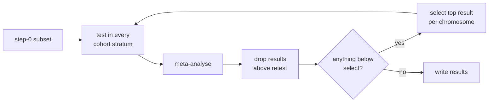

# Conditioning

The conditioning phases find the independent signals among the significant meta-analysis results by **federated forward selection**: signals are selected one at a time per chromosome, and the rest are retested conditional on them in every cohort stratum and meta-analysed again.

`conditioning_singles` conditions single variants; `conditioning_aggregates` conditions aggregates (unit and mask, across frequency bins). Phenotypes are conditioned separately, in parallel.

## The algorithm



1. **Step 0** starts from the [step-0 subset](meta-analysis.md#the-step-0-subset): meta-analysis results with p below `cond_p_*_retest`. Every candidate is tested in each cohort stratum and the results are meta-analysed.
2. After each step, results with p above `cond_p_*_retest` are dropped. With `cond_check_coll`, so are single variants too collinear with the selected set (r² reaching `cond_rsq_threshold`).
3. A chromosome is finished when no result is below `cond_p_*_select`, or when its only remaining result is, which is then selected.
4. Otherwise the next step selects the top result on each remaining chromosome and tests the rest conditional on everything selected so far.
5. When no chromosome is left, the results are written (see [Outputs](outputs.md#conditioning)).

Any `cond_file` variants are always conditioned on too.

## Thresholds

| Field | Default | Meaning |
|---|---|---|
| `cond_p_singles_retest` | `1e-6` | Single-variant results with p above this are dropped at each step and left out of the step-0 subset |
| `cond_p_singles_select` | `5e-8` | Single variants with p below this can be selected; must be ≤ the retest threshold |
| `cond_p_agg_retest` | `1e-6` | As above, for aggregates |
| `cond_p_agg_select` | `1e-7` | As above, for aggregates |
| `cond_rsq_threshold` | `0.9` | Most r² a single variant may have with the selected set; also the COJO collinearity cutoff for `mancojo` |
| `cond_check_coll` | `true` | Apply the `cond_rsq_threshold` check to single variants |
| `cond_max_steps` | `-1` | Most conditioning steps; -1 for no limit |

Changing a retest threshold changes the step-0 subset: run `step0_subset` again to build it. Earlier thresholds' subsets are kept.

If `cond_max_steps` is reached with signals left, partial results go to `<type>_cond_partial_results_step<N>/`, and the phenotype can be resumed with a higher limit and `--overwrite-config`.

## Engines

`cond_engine` sets how conditional statistics are derived.

`regenie` (default)
:   Reruns REGENIE at each step with the selected variants added as covariates.

`mancojo`
:   Projects the marginal statistics through an LD matrix (COJO). No joint model is fitted, so separation cannot arise, but it applies a linear-model approximation to log-odds effects, which degrades as odds ratios and case/control imbalance grow.

For `mancojo`, `cond_mancojo_effect_mode` is manc-cojo's `--effect-mode`:

| Mode | |
|---|---|
| `imputeNA` (default) | LD with missing genotypes mean-imputed, as in REGENIE; needs no sample sizes. Suits fedcat, where each job is one cohort and every SNP has the same samples. |
| `GCTA` | GCTA-COJO formulas, weighting by min(N_i, N_j) with N back-calculated per SNP from b and se, for meta-analysed GWAS with varying N. On binary traits those N vary only as an artefact of the log-odds scale. |
| `removeNA` | As `imputeNA`, but LD from samples observed for both SNPs; can give an indefinite LD matrix. |

## Binary traits

Binary phenotypes are not yet tested or recommended for conditioning. With the `regenie` engine, `cond_min_arm_ac` (default `0`) sets the minor-allele copies a conditioning variant needs in both cases and controls to be kept as a covariate.

## Running conditioning

Conditioning needs a `cond_suffix` in the config to name its run directories, so the same results can be conditioned several ways:

```bash
fedcat discover --config config.json --phases-to-run step0_subset conditioning_singles conditioning_aggregates
```

To start from a subset built elsewhere (single-phenotype runs only), pass `--cond-singles-tarball` or `--cond-agg-tarball`. See also [Running and resuming](running.md#conditioning-steps) for step controls, and [`fedcat summarise-indep`](../commands/summarise-indep.md) to rewrite a finished run's results.
