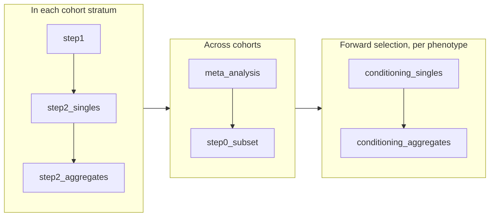

# How a run works

`fedcat discover` runs a sequence of **phases**. Each phase builds cloud jobs, submits them on each biobank's own platform, polls them until they finish, and saves its progress as it goes.

## Cohorts, strata and platforms

A run covers one or more **cohorts**, one per biobank (`aou`, `ukb`). Each cohort is split into **strata**, such as genetic ancestry groups, which are analysed separately and combined in the meta-analysis. A stratum's samples are those in its REGENIE step 1 input file; all strata share the cohort's phenotype and covariate files.

Each biobank runs its jobs on its own platform, where individual-level data stays:

| Biobank | Platform | Jobs | Paths in the config |
|---|---|---|---|
| AoU | Google Cloud Storage and Cromwell, via Verily Workbench | WDL workflows from [`aou_regenie_workflows`](https://github.com/ExeterGenetics/biobank_workflows/tree/main/regenie_workflows/aou_regenie_workflows), staged by [`fedcat setup-workflows`](../commands/setup-workflows.md) | `gs://` paths (prefix optional) |
| UKB | DNAnexus | Applets from [`ukb_regenie_apps`](https://github.com/ExeterGenetics/biobank_workflows/tree/main/regenie_workflows/ukb_regenie_apps) | file IDs or `project-xxx:/path` |

AoU workflows are submitted with the Workbench CLI by default, or to a Cromwell server you run yourself (see [`fedcat cromwell`](../commands/cromwell.md)).

## The phases



### step1

REGENIE step 1 fits the whole-genome regression for each cohort stratum, with all phenotypes together (or in sets of `step1_pheno_group_size`). Predictions are written to `step1_directory`. Set `step1_run_prefix` to share one fit between runs, e.g. runs that differ only in annotation version.

### step2_singles and step2_aggregates

REGENIE step 2 tests single variants with a minor allele count of at least `singles_mac_threshold`, and aggregates (burden tests from the cohort's `regenie_annotations`) in each `aggregate_freqs` allele-frequency bin. Jobs are split into genomic blocks from the variant density block file. Blocks grow longer as strata get smaller, so accurate `cohort_sizes` make jobs cheaper; `max_step2_singles_block_length` and `max_step2_aggregates_block_length` cap them. `--run-blockfile` restricts testing to given regions.

When a cohort has a `cond_file`, step 2 also tests single variants conditional on those variants.

### meta_analysis

When the meta-analysis runs in AoU (`meta_analysis_config.location` is `aou`), UKB summary statistics are first copied into the AoU bucket. All cohorts and strata are then combined by inverse-variance weighted fixed-effects meta-analysis, and ACAT tests combine each aggregate's burden and single-variant results. `--meta-mode` picks the result types to meta-analyse. See [Meta-analysis and ACAT](meta-analysis.md).

### step0_subset

Collects the meta-analysis results significant at `cond_p_singles_retest` and `cond_p_agg_retest` as the starting point for conditioning. Subsets are kept per threshold: those the meta-analysis built are reused, and new thresholds are built from the meta-analysis outputs in the cloud.

### conditioning_singles and conditioning_aggregates

Federated forward selection, per phenotype: each cohort stratum tests the remaining signals conditional on those selected so far, the results are meta-analysed, the top signal on each chromosome is selected, and this repeats until nothing is left below the selection threshold. See [Conditioning](conditioning.md).

## Choosing phases

By default `fedcat discover` runs every phase, starting from the latest one it has state for. Run a subset with `--phases-to-run`, in run order:

```bash
# Discovery only, no conditioning
fedcat discover --config config.json --phases-to-run step1 step2_singles step2_aggregates meta_analysis

# Conditioning from a meta-analysis already in the cloud
fedcat discover --config config.json --phases-to-run step0_subset conditioning_singles conditioning_aggregates
```

Only the config a run's phases use is required: e.g. a singles-only run needs no annotations.

!!! warning "Interaction runs"

    With `interaction` set (GxE testing), only single-variant phases are supported; `step2_aggregates` and the conditioning phases are refused.

## State and resuming

Each phase's progress is saved to `discovery_state_<phase>.json` in the run directory as it goes and on any error; each conditioning step has its own state file. Running the same command again resumes the run, picking up running jobs rather than resubmitting them. See [Running and resuming](running.md).
